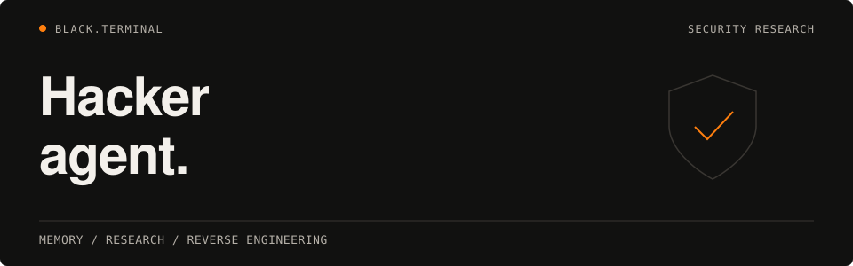

<h1>
  <picture>
    <source media="(max-width: 600px)" srcset="assets/readme/hero-mobile.svg">
    
  </picture>
</h1>

**hacker-agent** is a permanent-memory toolkit for authorized security research and reverse engineering. SQLite memory, CVE/CISA KEV ingestion, audit checklists, a Ghidra MCP catalog, and Stake Engine math helpers run through a Python CLI.

**[Install](#install)** · [Run](#run) · [Usage examples](#usage-examples) · [Configuration](#configuration-and-environment-variables) · [Quality gates](#quality-gates)

[](https://github.com/subkoks/hacker-agent/actions/workflows/ci.yml)
[](https://github.com/subkoks/hacker-agent/releases/latest)
[](https://www.python.org/downloads/)
[](LICENSE)

> **Authorized testing only.** Use only with explicit written scope (contract,
> Rules of Engagement, or program rules). See [`docs/SECURITY.md`](docs/SECURITY.md)
> for disclosure policy and [`docs/SECURITY.md#authorized-use`](docs/SECURITY.md#authorized-use)
> for the project’s stance on out-of-scope use.

## Requirements

| Requirement | Notes |
|-------------|--------|
| **Python 3.13+** | `requires-python = ">=3.13"` in `pyproject.toml`. [`pyenv`](https://github.com/pyenv/pyenv) matches the pinned `.python-version`. |
| **[uv](https://github.com/astral-sh/uv)** | Recommended install and task runner (`uv sync`, `uv run …`). |
| **Bash + common Unix utilities** | `scripts/auto-mode.sh` uses `bash`, `find`, `tar`, `git`. macOS and Linux are first-class; Windows is unsupported except via **WSL2**. |

## Install

### 1. Clone and enter the tree

```bash
git clone https://github.com/subkoks/hacker-agent.git
cd hacker-agent
# main is the default branch; use tags for releases
```

### 2. Create the environment

**With uv (recommended)**

```bash
# Production / runtime dependencies only
uv sync

# Add dev tools (pytest, ruff, mypy, bandit, respx)
uv sync --extra dev
```

**With pip (editable install)**

```bash
python3.13 -m venv .venv
source .venv/bin/activate          # Linux / macOS
# .venv\Scripts\activate           # Windows cmd (unsupported except WSL)

pip install -U pip
pip install -e ".[dev]"            # or pip install -e .   without dev extras
```

After any editable install, the console script `hacker-agent` is available when
the virtual environment is activated. With **uv** and no shell activation, use
`uv run hacker-agent …` (see [Run](#run)).

### 3. Optional: verify

```bash
uv run hacker-agent --version
uv run python -m hacker_agent --version
```

## Run

### Day-to-day CLI (local / “production”)

With **uv** (no manual `activate`):

```bash
uv run hacker-agent --help
uv run python -m hacker_agent --help
```

With an **activated** virtualenv after `pip install -e .`:

```bash
hacker-agent --help
python -m hacker_agent --help
```

There is no separate long-running server process; each command exits when finished.

### Development commands

Mirror CI locally:

```bash
uv run ruff check src tests
uv run ruff format --check src tests
uv run mypy src
uv run pytest -q --cov=src/hacker_agent
```

See [`CONTRIBUTING.md`](CONTRIBUTING.md) for branch flow (feature branch → PR →
`main`) and review expectations.

## Usage examples

```bash
# Knowledge ops
hacker-agent learn --content "JWT 'none' alg bypass" --category technique --importance 8
hacker-agent recall --query "JWT" --limit 5
hacker-agent dashboard

# CVE feed import (NVD + CISA KEV — network required)
hacker-agent cve import --days 7
hacker-agent cve import --kev-only

# Audit checklists
hacker-agent audit list
hacker-agent audit generate --type web-application --format markdown

# Stake-style RGS math (simulation helpers)
hacker-agent stake verify-rtp --game crash --rounds 100000

# Ghidra MCP catalog + workflow text (see below)
hacker-agent ghidra tools
hacker-agent ghidra guide
```

## Configuration and environment variables

1. Copy the template: `cp .env.example .env` and edit values for your machine.
2. **This package does not auto-load `.env`.** Export variables in your shell,
   use [`direnv`](https://direnv.net/), or wrap commands, for example:

   ```bash
   set -a && source .env && set +a && uv run hacker-agent dashboard
   ```

Resolved paths are **project-root relative** unless an absolute path is given
(see `src/hacker_agent/config.py`).

| Variable | Purpose | Default |
|----------|---------|---------|
| `HACKER_DATA_DIR` | Directory for SQLite and default dump paths | `<repo>/data` |
| `HACKER_MEMORY_DB` | SQLite database file | `<data>/hacker-memory.db` |
| `HACKER_LOG_DIR` | `auto-mode` / `auto-commit` logs | `<repo>/logs` |
| `HACKER_BACKUP_DIR` | `auto-mode` tarball backups | `<repo>/backups` |
| `HACKER_AUTO_INTERVAL` | Seconds between daemon cycles in `scripts/auto-mode.sh start` | `3600` |
| `NVD_API_BASE` | NVD CVE 2.0 JSON endpoint | Public NVD URL in `.env.example` |
| `CISA_KEV_URL` | CISA KEV JSON feed URL | Official CISA URL |
| `AUTO_COMMIT_BRANCH_PREFIX` | Prefix for branches created by `scripts/auto-commit.sh` on `main`/`master` | `auto/` |
| `GHIDRA_PROJECT_DIR` | Default Ghidra project directory hint (`GhidraIntegration`) | `~/Projects/ghidra-re/projects` |
| `GITHUB_TOKEN` | **Not read by the Python package today**; reserved for local GitHub automation you may layer on (for example `gh` auth). | _(empty)_ |

Show the resolved database path:

```bash
uv run hacker-agent memory path
```

## VS Code, Codex, and Ghidra MCP

- **Microsoft VS Code / OpenAI Codex**: Open the repository with `code .` and use
  the official Codex extension or `codex` in the integrated terminal. The preferred
  model is GPT-6.1 Sol (`gpt-6.1-sol`). Repository guidance is in
  [`AGENTS.md`](AGENTS.md), with project settings in [`.codex/config.toml`](.codex/config.toml).
  Use your existing user-level OpenAI provider/login configuration; no Anthropic
  setup or legacy installer is required. Run `uv run hacker-agent …` from the terminal.
- **Legacy compatibility**: [`.cursor/agents/`](.cursor/agents/) and
  [`.claude/agents/`](.claude/agents/) retain historical agent definitions.
  `install.sh` wires legacy Claude/Cursor symlinks; it is not a Codex installer.
- **Repository link previews**: Upload [`.github/social-preview.png`](.github/social-preview.png)
  under the repository’s **Settings → General → Social preview** on GitHub (under **1 MB**;
  use [`.github/repository-open-graph-template.png`](.github/repository-open-graph-template.png)
  for safe margins).
- **Ghidra MCP**: The `ghidra` package submodule lists **expected MCP tool names**
  and prints a **workflow guide** to stdout. Disassembly and MCP calls execute
  in your Ghidra-backed MCP server and host agent, not inside `hacker-agent`
  itself. Wire a Ghidra MCP server in your editor, then use `hacker-agent ghidra
  record` to persist snapshots into SQLite when you have JSON / decompilation
  artifacts on disk.

## Automation scripts (`scripts/`)

`scripts/auto-mode.sh` runs health checks, tarball backups (including a brain
export when the CLI succeeds), optional auto-commit via `auto-commit.sh`, and a
lightweight upstream notice. **Daemon / backup paths expect `python3` and
`python3 -m hacker_agent` on `PATH`** (your venv or uv shim).

```bash
export PATH="$PWD/.venv/bin:$PATH"    # example after venv activate
scripts/auto-mode.sh once             # single cycle
scripts/auto-mode.sh start            # background daemon (uses HACKER_AUTO_INTERVAL)
scripts/auto-mode.sh status
scripts/auto-mode.sh stop
scripts/auto-mode.sh health           # one-shot compile + CLI smoke
scripts/auto-mode.sh backup           # backup only
```

`scripts/auto-commit.sh` creates commits on a safe feature branch when run from
`main`/`master`, and attempts `git push` if `origin` exists — configure Git
credentials / SSH as you normally would for pushes.

## Security and compliance

- Treat imported **brain dumps**, **CVE JSON**, and **Ghidra triage files** as
  untrusted input; keep filesystem permissions tight on `HACKER_MEMORY_DB` and
  backups.
- **NVD API** calls use the public endpoint; respect [NIST usage
  expectations](https://nvd.nist.gov/developers/start-here) and your corporate
  egress policy. There is **no** `NVD_API_KEY` wiring in this codebase yet.
- Do **not** use this tool against systems you are not explicitly authorized to
  test.

## Codex CLI

Codex uses the repository's [`AGENTS.md`](AGENTS.md) guidance. In a trusted project,
the tracked [`.codex/config.toml`](.codex/config.toml) selects `gpt-6.1-sol`, workspace
write access, and approval prompts. Provider/login settings stay in your existing
user configuration. Start `codex` from the repository root; no `install.sh` step is
needed. See the official [configuration reference](https://learn.chatgpt.com/docs/config-file/config-reference)
and [AGENTS.md guide](https://learn.chatgpt.com/docs/agent-configuration/agents-md).

## Quality gates

```bash
ruff check src tests
ruff format --check src tests
mypy src
pytest -q
```

(Prefer `uv run …` as shown in [Development commands](#development-commands).)

## Repository layout

<details>
<summary>Python package, automation, tests, and data</summary>

```
src/hacker_agent/
├── config.py            # Path + env resolution (no hardcoded absolute paths)
├── memory/              # SQLite knowledge base + Pydantic models
├── cli/                 # Typer CLI (`python -m hacker_agent` / `hacker-agent`)
├── cve/                 # NVD + CISA KEV importer (direct HTTP, no subprocess)
├── stake/               # Provably-fair game math + RGS templates
├── audit/               # Security-audit checklist generator
└── ghidra/              # Ghidra MCP tool catalog + memory bridge
scripts/                 # Bash automation (auto-mode, auto-commit)
tests/                   # pytest suite
data/                    # Default SQLite location (gitignored; `.gitkeep` tracked)
```

</details>

## Links

- Repository: <https://github.com/subkoks/hacker-agent>
- Latest release: <https://github.com/subkoks/hacker-agent/releases/latest>
- Issues: <https://github.com/subkoks/hacker-agent/issues>
- NVD CVE 2.0 API: <https://nvd.nist.gov/developers/vulnerabilities>
- CISA KEV catalog: <https://www.cisa.gov/known-exploited-vulnerabilities-catalog>
- Stake Engine docs: <https://docs.stake-engine.com>

## Contributing

See [`CONTRIBUTING.md`](CONTRIBUTING.md) for development setup, branch flow, and
code standards. Vulnerability reports go through [`docs/SECURITY.md`](docs/SECURITY.md),
not public issues. Community expectations live in [`CODE_OF_CONDUCT.md`](CODE_OF_CONDUCT.md).
User-visible changes are recorded in [`docs/CHANGELOG.md`](docs/CHANGELOG.md).

## License

[MIT](LICENSE)

---

 **BLACK.TERMINAL** · [MIT License](LICENSE) · [GitHub](https://github.com/subkoks)
